<div align="center">

# Fredrick Ondara — Portfolio

**Electrical & Electronic Engineering student · Telecom, embedded systems & web**
<br/>
A minimalist, interactive 3D portfolio built with Next.js, React Three Fiber and GSAP.

[](https://nextjs.org)
[](https://r3f.docs.pmnd.rs)
[](https://www.typescriptlang.org)
[](https://tailwindcss.com)
[](https://gsap.com)
[](https://vercel.com/new/clone?repository-url=https%3A%2F%2Fgithub.com%2FFRED-ONDARA%2Fportfolio)

<br/>

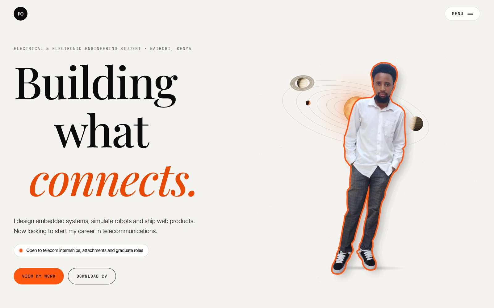

</div>

---

## The idea

Photo cutouts of me float in a calm 3D space built around one idea: **signal**. The hero opens on a quiet,
realistic solar system. Further down, each figure stands in a warm **aura** of slowly drifting contour lines,
on a **dot-field floor** where ripples spread out from my feet like a radio signal. In the telecom tab, a bundle of
**fiber-optic strands** carries pulses of light behind me, and a few **flowers** add a softer touch. Each section is a
split screen, with a 3D visual on one side and a short explanation on the other. Headlines are set in
**Playfair Display**, with one italic orange line.

<div align="center">
  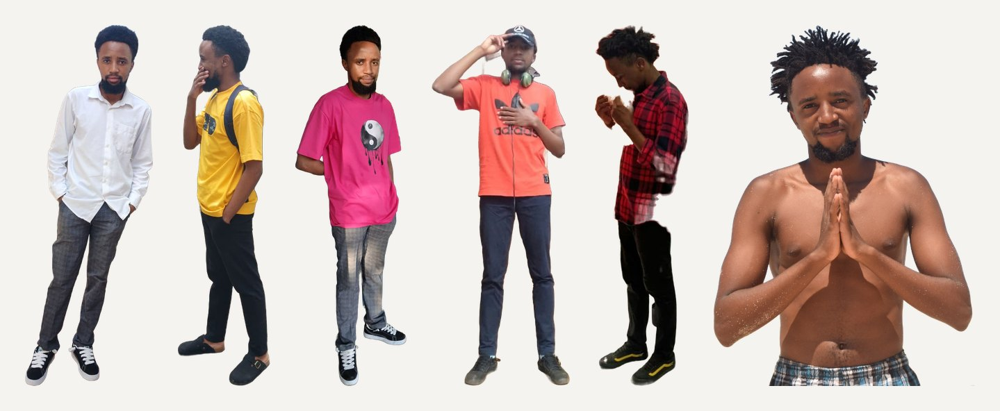
  <sub>The six cutouts used across the site. Backgrounds were removed from my photos and every figure gets the same outline, shadow and float treatment.</sub>
</div>

## Preview

<table>
  <tr>
    <td width="50%">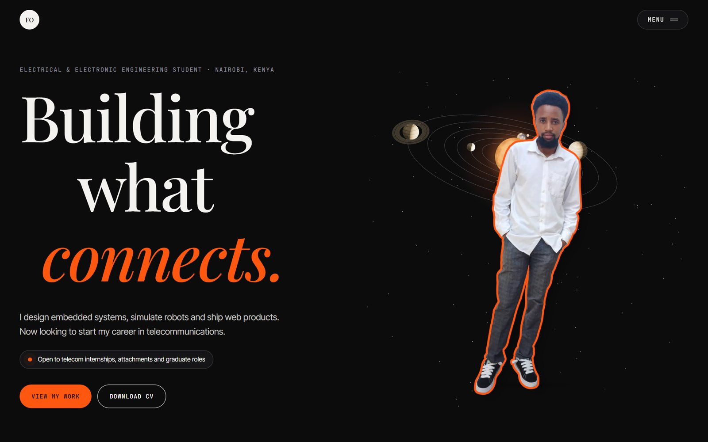<br/><sub><b>Dark mode</b>: the solar system against a starfield</sub></td>
    <td width="50%">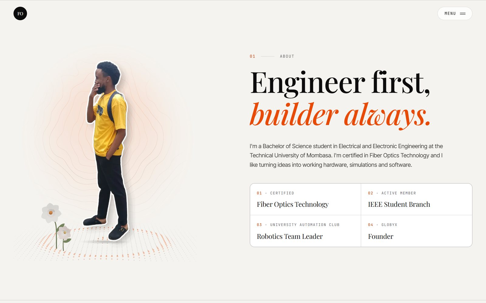<br/><sub><b>01 About</b>: contour aura, signal floor and flowers</sub></td>
  </tr>
  <tr>
    <td>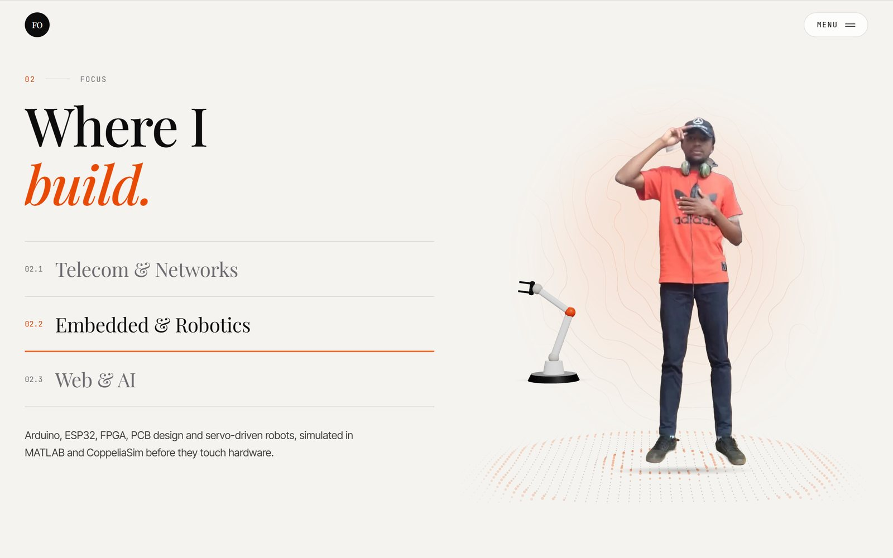<br/><sub><b>02 Focus</b>: tabs swap the copy, the figure and the 3D object (fiber strands, robot arm, code window)</sub></td>
    <td>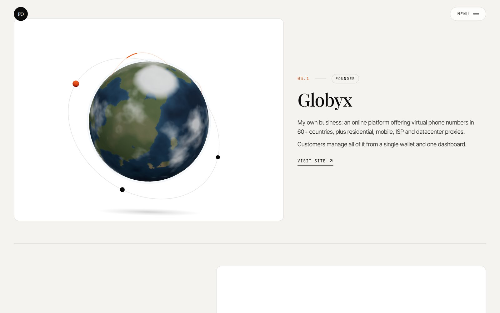<br/><sub><b>03 Projects</b>: Globyx, shown as a realistic Earth with connection arcs</sub></td>
  </tr>
  <tr>
    <td>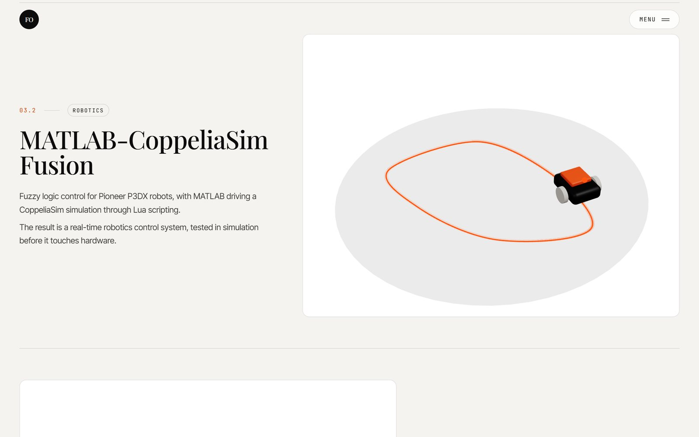<br/><sub>MATLAB–CoppeliaSim: a rover following a glowing path</sub></td>
    <td>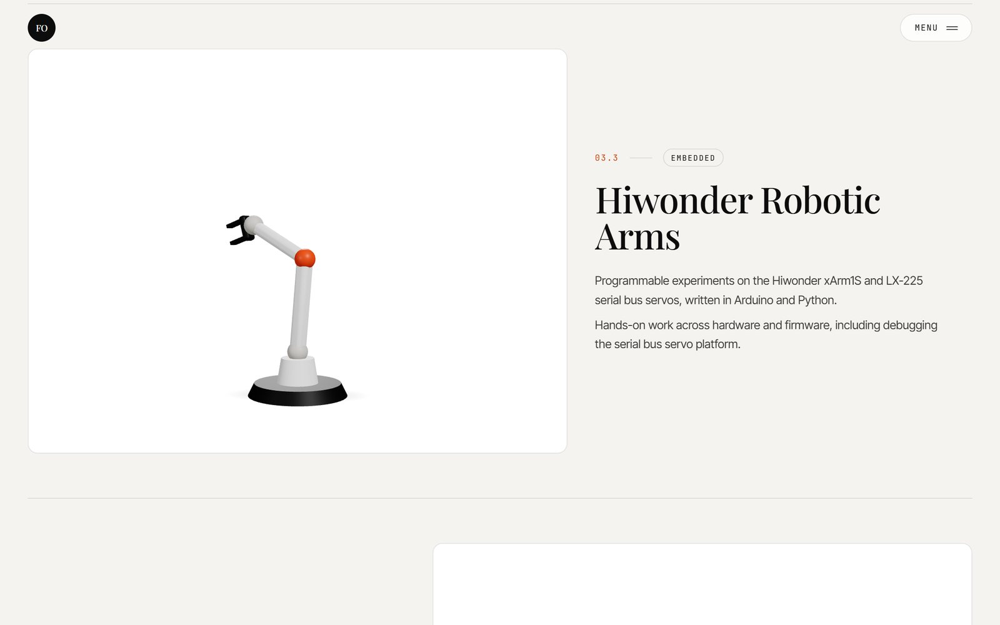<br/><sub>Hiwonder: an articulated arm built from primitives</sub></td>
  </tr>
  <tr>
    <td>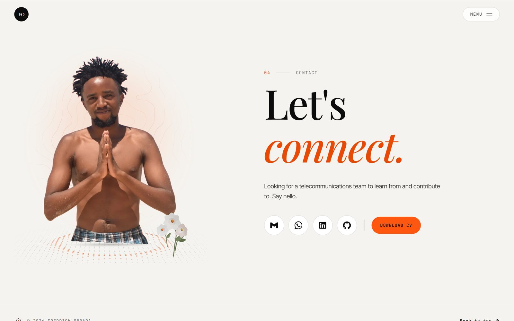<br/><sub><b>04 Contact</b>: brand-icon links, CV download and a small bouquet</sub></td>
    <td>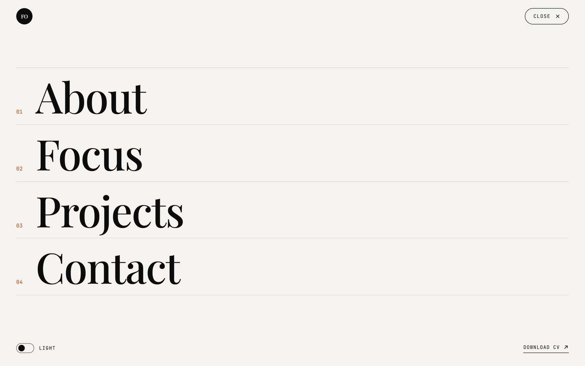<br/><sub>Full-screen menu with numbered links and theme toggle</sub></td>
  </tr>
</table>

<p align="center">
  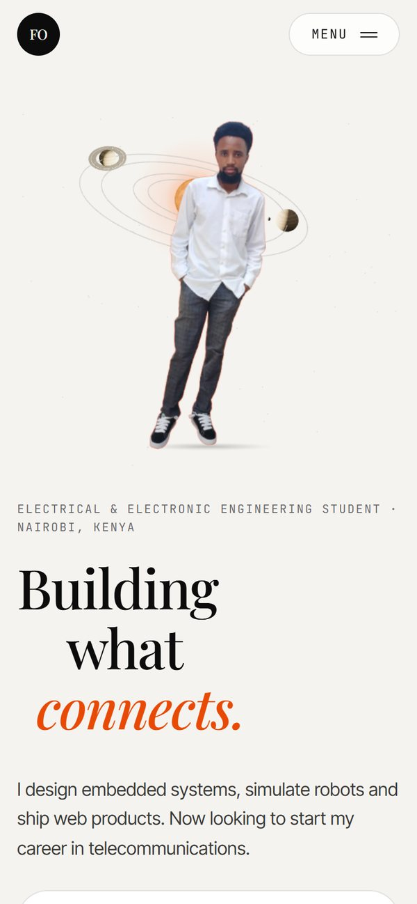
  &nbsp;&nbsp;
  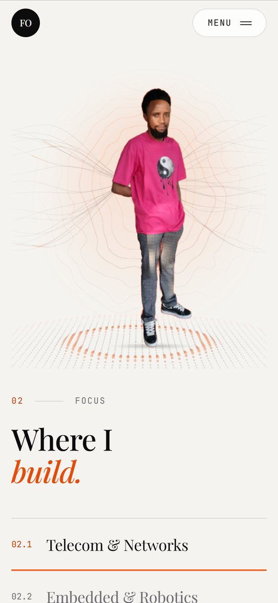
  <br/><sub>On mobile, layouts stack with the visual on top, and the 3D scenes use fewer objects.</sub>
</p>

## Highlights

- **One shared WebGL canvas.** Each section's image slot is a drei `<View>`, so every scene renders into a single GPU context, clipped to its box.
- **Cutout shader.** Each photo is a plane at its natural aspect ratio. A custom shader draws an alpha-edge outline (white, or orange on hover) and a soft drop shadow; a contact shadow sits underneath.
- **Alive but calm.** Figures float, tilt toward the cursor (or follow device orientation on phones) and scale up slightly on hover. The camera glides with scroll through GSAP ScrollTrigger, and Lenis smooths the scroll.
- **Signal backdrops.** Three custom shaders, one draw call each: a contour aura (noise isolines around a warm glow), a dot floor whose ripples spread from the figure, and fiber strands with travelling light pulses. All of them fade out before their edges, so nothing is clipped.
- **A procedural solar system in the hero.** The sun has an animated plasma shader and a soft corona. The planet textures are generated in code, and the planets are lit by the sun, so each shows a day and a night side.
- **Flowers, sparingly.** Hand-built 3D blossoms with cupped, curled petals in About and Contact, plus a line-drawn flower in the footer.
- **Real brand icons** for Gmail, WhatsApp, LinkedIn and GitHub, each filling with its brand colour on hover.
- **Generated project visuals.** An Earth with connection arcs, a rover, a robot arm and a typing terminal, all built from primitives, so there are no heavy models to download.
- **Fast first paint.** The initial page is about 500 KB. three.js loads only after the first interaction, and each scene is built only as its section approaches. 3D textures arrive as compressed WebP through Next's image optimizer (the contact cutout drops from 558 KB to 43 KB). Repeat visits in a session get a quick intro.
- **Accessible.** Semantic landmarks, keyboard-operable tabs (arrow keys) and menu (focus trap, `Esc` closes), visible focus states, and `prefers-reduced-motion` support. Without WebGL, static images are shown instead.
- **Editable content.** All copy lives in one file, and all images are mapped in another.

## Tech stack

| Area | Tools |
| --- | --- |
| Framework | Next.js 16 (App Router), React 19, TypeScript |
| Styling | Tailwind CSS 4, `next/font` (Playfair Display headlines, Inter Tight body, JetBrains Mono labels) |
| 3D | three.js, @react-three/fiber, @react-three/drei |
| Motion | GSAP + ScrollTrigger, Lenis, framer-motion |
| Hosting | Vercel (fully static output) |

## Getting started

Requires **Node.js 20+**.

```bash
git clone https://github.com/FRED-ONDARA/portfolio.git
cd portfolio
npm install
npm run dev        # http://localhost:3000
```

| Command | What it does |
| --- | --- |
| `npm run dev` | Start the dev server |
| `npm run build` | Production build |
| `npm start` | Serve the production build |
| `npm run preview` | Build and serve the production version (fast, like the live site) |
| `npm run lint` | ESLint |

## Editing content

**All text** lives in [`src/content/site.ts`](src/content/site.ts): the hero, about facts, focus tabs, projects,
contact links, footer and SEO title/description. Change it there; no component edits are needed.

## Adding or swapping images

Cutouts are transparent PNGs in [`public/images/`](public/images/), mapped in [`src/content/images.ts`](src/content/images.ts):

| Key | File | Used in |
| --- | --- | --- |
| `hero` | `hero.png` | Hero |
| `about` | `about.png` | 01 About |
| `focus-telecom` · `focus-robotics` · `focus-web` | `focus-*.png` | 02 Focus tabs |
| `contact` | `contact.png` | 04 Contact |

To use a new photo:

1. Save it as a **transparent PNG** (only the person visible), ideally 1,000–1,400 px tall.
2. Drop it in `public/images/`.
3. Point a key at it in `src/content/images.ts`, for example `contact: { src: "/images/my-new-photo.png", alt: "…" }`.

Figures are normalized by height and never stretched. If a file is missing, the site falls back to `hero.png`,
and then to a placeholder silhouette.

**Project screenshots (optional):** add `public/images/projects/<slug>.png` (`globyx`, `matlab-coppeliasim`,
`hiwonder-arms`, `terminal-bench-3`). The site shows it on a floating plane instead of the generated visual.

## CV files

Both CVs live in [`public/cv/`](public/cv/):

- `Fredrick_Ondara_CV.pdf`: the designed two-column CV, linked by every **Download CV** button
- `Fredrick_Ondara_CV_ATS.pdf`: the plain single-column version

Replace the files and keep the same names, or change `site.cv` in `site.ts`.

## Deploy to Vercel

1. Push to GitHub (this repo).
2. Go to [vercel.com/new](https://vercel.com/new), import `FRED-ONDARA/portfolio`, and keep the defaults (Next.js is detected automatically).
3. Click **Deploy**. Later pushes to `main` redeploy automatically.

The canonical URL, sitemap and Open Graph tags use Vercel's production domain automatically. If you use a custom
domain, set `NEXT_PUBLIC_SITE_URL` (for example `https://fredrickondara.com`) in the Vercel project settings.

## Project structure

```
src/
├─ app/                 layout, page, metadata, sitemap, robots, OG image, icon
├─ content/
│  ├─ site.ts           ← all copy and links
│  └─ images.ts         ← image mappings
├─ components/
│  ├─ Hero · About · Focus · Projects · Contact · Footer
│  ├─ Header · MenuOverlay · Loader · Cursor · ThemeToggle
│  ├─ Visual.tsx        section image slot (3D or static fallback)
│  └─ three/
│     ├─ CanvasRoot     the single shared Canvas
│     ├─ ViewSlot       anchors a scene to a section's slot
│     ├─ SlotScene      picks the scene per section
│     ├─ CutoutFigure   reusable 3D cutout (outline + shadow shader)
│     ├─ Scene          studio lights, parallax, contact shadow
│     ├─ backdrops      contour aura, signal floor, fiber bundle
│     ├─ cosmos         sun, planets, Earth, starfield, solar system
│     ├─ flowers        blossoms and bouquet
│     ├─ textures       procedural planet, cloud, ring and glow textures
│     └─ visuals        Earth globe, rover, robot arm, terminal, code window
└─ lib/                 stores, hooks, scroll, GSAP setup, image resolver
public/
├─ images/              cutouts (+ optional projects/ screenshots)
└─ cv/                  CV PDFs
```

## Performance & accessibility

Lighthouse on the production build, run locally:

| | Performance | Accessibility | Best Practices | SEO |
| --- | --- | --- | --- | --- |
| Desktop | 93 | 100 | 100 | 100 |
| Mobile (simulated slow 4G) | ~65–70 | 100 | 100 | 100 |

On mobile, Lighthouse's simulated throttling counts the JavaScript for the intro loader and animations against
the first paint. A direct 4× CPU-throttled measurement painted the hero at about 1.3 s.

---

<div align="center">

**Fredrick Ondara** · Nairobi, Kenya
<br/>
[LinkedIn](http://www.linkedin.com/in/fredrick-ondara-617570339) · [GitHub](https://github.com/Fredrick-Ondara-Onenga) · [Email](mailto:fredrickondara01@gmail.com)

<sub>Open to telecom internships, attachments and graduate roles.</sub>

</div>
